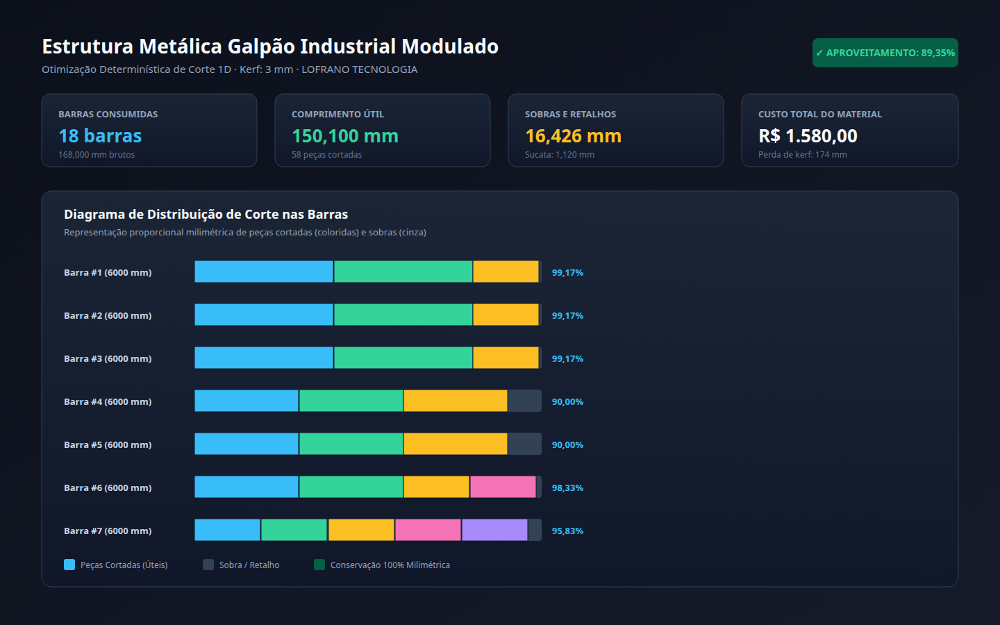

# Otimização de Plano de Corte Unidimensional (1D)

[](https://github.com/martinlofranodeoliveira/plano-corte-barras/actions/workflows/ci.yml)
[](https://www.python.org/downloads/)
[](LICENSE)
[-brightgreen.svg)](#)

Motor determinístico de otimização de plano de corte linear (*1D Cutting Stock / Bin Packing*) para vergalhões de aço da construção civil, tubos, perfis metálicos de serralheria, alumínio, marcenaria e tubulações industriais.

Garante aproveitamento máximo de material, redução drástica de sobras e controle milimétrico estrito de espessura de lâmina/disco de corte (*kerf*) e refugo de ponta.



---

## Destaques de Engenharia

- **Aritmética Inteira Exata (Zero Floats):** Comprimentos, posições, espessuras de serra e sobras operam em milímetros inteiros (`int`). Custos em centavos inteiros (`int`). Banimento total de números de ponto flutuante.
- **Conservação Geométrica Milimétrica:** Em todas as barras brutas consumidas, a soma de refugo de ponta, peças úteis, perdas de corte e sobra final fecha exatamente no comprimento total da barra:
  $$\text{refugo\_ponta} + \sum (\text{peca.comprimento} + \text{kerf}) + \text{sobra\_final} \equiv \text{comprimento\_total}$$
- **Controle de Espessura de Corte (Kerf) e Margem de Ponta:** Desconta com precisão milimétrica a espessura do disco de serra ou maçarico em cada corte realizado e a regularização inicial da ponta da barra bruta.
- **Classificação de Retalhos (Aproveitável vs Sucata):** Diferencia automaticamente sobras que atendem ao comprimento mínimo útil para reincorporação ao estoque de inventário daquelas que constituem sucata descartável.
- **Roteiro de Oficina para Chão de Fábrica:** Gera lista de corte detalhada em Markdown e CSV com indicação da posição inicial e final na escala da máquina corte a corte.
- **Segurança Ativa em CSV:** Prevenção contra injeção de fórmulas (*CSV/Formula Injection*) com prefixação automática de `'` em caracteres potencialmente maliciosos (`=`, `+`, `-`, `@`, `\t`).
- **Codec JSON Canônico:** Rejeição de floats, chaves duplicadas, assinaturas BOM e recursão excessiva.
- **Empacotamento Determinístico em ZIP:** Criação atômica via `os.O_EXCL` e timestamps fixados para garantia de reprodutibilidade bit a bit.
- **Zero Dependências Externas:** Executa puramente sobre a biblioteca padrão do Python 3.11+.
- **Auditor Independente:** Script autônomo (`tools/verify_independent.py`) que audita os CSVs em `sqlite3` sem importar o pacote de produção.

---

## Instalação

```bash
# Instalação a partir do repositório
pip install git+https://github.com/martinlofranodeoliveira/plano-corte-barras.git

# Ou clone para desenvolvimento local
git clone https://github.com/martinlofranodeoliveira/plano-corte-barras.git
cd plano-corte-barras
pip install -e .
```

---

## Uso Rápido via CLI

```bash
# 1. Exibir versão instalada
plano-corte-barras versao

# 2. Gerar arquivo JSON de exemplo canônico
plano-corte-barras exemplo -o entrada.json

# 3. Validar viabilidade e estoque antes de cortar
plano-corte-barras verificar -i entrada.json

# 4. Visualizar roteiro de corte em Markdown no terminal
plano-corte-barras resumo -i entrada.json

# 5. Otimizar plano de corte e gerar artefatos analíticos
plano-corte-barras processar \
  -i entrada.json \
  -d ./saida \
  -z ./saida/plano-corte.zip
```

---

## Exemplo de Entrada

```json
{
  "projeto": {
    "nome": "Estrutura Metálica Galpão Industrial Modulado"
  },
  "parametros": {
    "espessura_corte_mm": 3,
    "comprimento_minimo_aproveitavel_mm": 500,
    "margem_seguranca_ponta_mm": 10
  },
  "estoque_barras": [
    {
      "id": "BARRA-6M-TUBO50",
      "perfil": "TUBO_50X50_2MM",
      "comprimento_mm": 6000,
      "quantidade": 15,
      "custo_unitario_centavos": 14500
    }
  ],
  "pecas_demandadas": [
    {
      "id": "MONTANTE-A",
      "perfil": "TUBO_50X50_2MM",
      "comprimento_mm": 2400,
      "quantidade": 6,
      "descricao": "Montante Vertical Principal"
    },
    {
      "id": "TRAVESSA-B",
      "perfil": "TUBO_50X50_2MM",
      "comprimento_mm": 1800,
      "quantidade": 8,
      "descricao": "Travessa Horizontal de Reforço"
    }
  ]
}
```

---

## Artefatos Gerados

| Arquivo | Descrição |
| :--- | :--- |
| `plano-corte.csv` | Tabela corte a corte com posições milimétricas de início/fim e perdas de serra |
| `resumo-barras.csv` | Totais consolidados de cada barra consumida e taxa de aproveitamento |
| `lista-corte.md` | Roteiro de oficina para o operador da máquina de corte |
| `diagrama-corte.svg` | Painel gráfico vetorial (1440×900) ilustrando o plano físico de cada barra |
| `plano.json` | Memória de cálculo estruturada para integração com PCP e ERP |
| `SHA256SUMS` | Manifesto criptográfico SHA-256 de auditoria e verificação de integridade |

---

## Verificação e Auditoria Independente

```bash
python3 tools/verify_independent.py saida/plano-corte.zip
```

Saída esperada:
```
=== Auditoria Independente: plano-corte.zip ===
  ✓ Integridade criptográfica SHA-256 verificada com sucesso em todos os artefatos.
  ✓ Conservação e alinhamento geométrico milimétrico confirmados em todas as 18 barras.
  ✓ Todas as 58 peças demandadas foram cortadas com dimensões exatas.
  • Aproveitamento Global Auditado: 150100 mm / 168000 mm (89.35%)
=== Auditoria Independente APROVADA com 100% de sucesso! ===
```

---

## Documentação Técnica

- [Especificação de Formato JSON e CSV](docs/FORMATO.md)
- [Referência da API Python](docs/API.md)
- [Prova Matemática e Verificação Independente](docs/VERIFICACAO.md)
- [Guia de Interoperabilidade e Integração PCP/ERP](docs/INTEROPERABILIDADE.md)

---

## Licença

Distribuído sob a licença **MIT**. Consulte o arquivo [LICENSE](LICENSE) para mais detalhes.

Copyright (c) 2026 Martin Lofrano / **LOFRANO TECNOLOGIA**.
